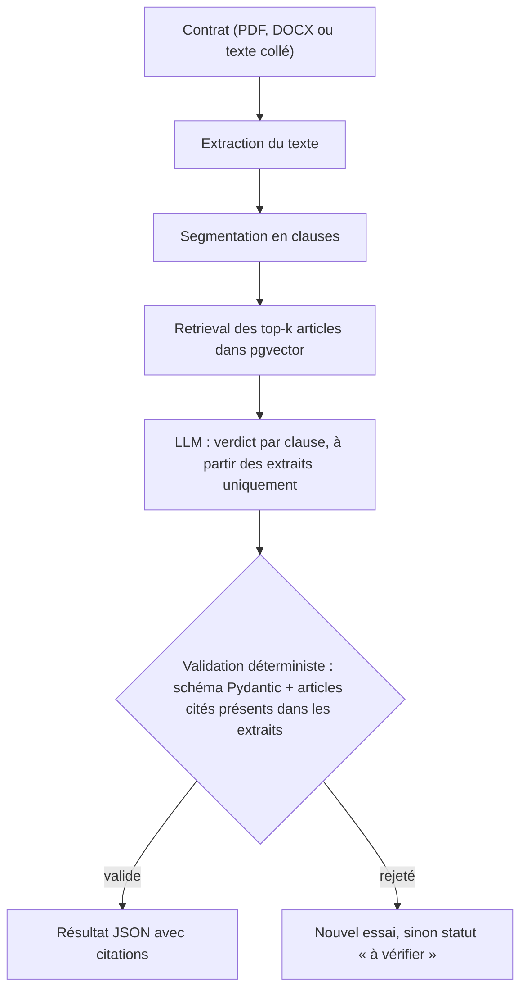
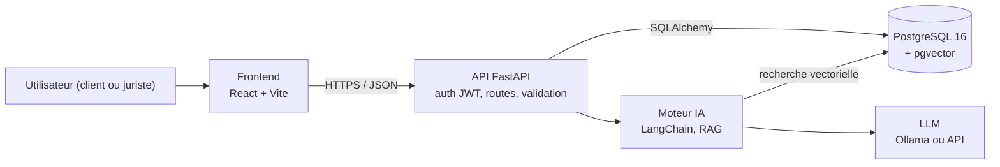

<div align="center">

# ⚖️ I-Légale

**Vérifiez la conformité d'un contrat de travail au droit français, clause par clause, avec les articles du Code du travail à l'appui.**


</div>

> I-Légale est une application web qui analyse un contrat de travail clause par clause et indique si chacune est **conforme**, **non conforme** ou **à vérifier**.
> Un **RAG** construit sur le Code du travail cite à chaque fois les articles applicables, sans jamais inventer de source.
> Elle s'adresse aux salariés, aux petits employeurs et aux juristes.

*Projet Fédérateur — Classe ISIL 3-1 · Module Développement Fullstack & Intégration IA*

---

## Sommaire

- [Problème et utilisateurs](#-problème-et-utilisateurs)
- [Comment fonctionne l'IA](#-comment-fonctionne-lia)
- [Fonctionnalités](#-fonctionnalités)
- [Architecture et stack](#-architecture-et-stack)
- [Données et sources](#-données-et-sources)
- [Prérequis d'installation](#-prérequis-dinstallation)
- [Démarrage](#-démarrage)
- [Structure du dépôt](#-structure-du-dépôt)
- [Workflow Git](#-workflow-git)
- [Feuille de route](#-feuille-de-route)
- [Équipe](#-équipe)
- [Documentation](#-documentation)
- [Avertissement](#-avertissement)

---

## 🎯 Problème et utilisateurs

Un salarié qui reçoit un contrat de travail, ou un petit employeur qui le rédige à partir d'un modèle trouvé en ligne, ne peut pas facilement savoir si chaque clause respecte la loi : période d'essai, non-concurrence, durée du travail, rémunération, rupture, mobilité… Il doit chercher à la main dans des milliers d'articles ou payer un juriste. Une clause irrégulière passe alors inaperçue et peut causer un litige.

I-Légale remplace cette recherche manuelle, qui prend plusieurs dizaines de minutes, par une analyse en moins d'une minute.

| Utilisateur | Besoin |
|---|---|
| **Client** : salarié ou dirigeant de TPE, sans formation juridique | Savoir quelles clauses sont conformes, risquées ou à faire vérifier, avec des explications simples |
| **Juriste** : juriste RH ou avocat en droit social | Obtenir un pré-audit sourcé, avec les articles applicables, pour gagner du temps sur les vérifications répétitives |

## 🤖 Comment fonctionne l'IA

Une même règle s'écrit de dizaines de façons dans un contrat : des règles `if/else` ne suffisent pas. Un LLM seul inventerait des articles ou citerait des règles abrogées. Le **RAG** (*Retrieval-Augmented Generation*) ancre donc chaque verdict sur le texte légal en vigueur et impose la citation des sources. Quand rien de pertinent n'est retrouvé, le système répond **« à vérifier »** et n'invente jamais.



Le garde-fou anti-hallucination est **déterministe** : un article cité qui ne figure pas dans les passages récupérés est rejeté par la validation, quoi qu'ait écrit le LLM.

### Exemple de sortie

```json
{
  "clause_id": "c3",
  "category": "periode_essai",
  "status": "non_conforme",
  "risk_level": "eleve",
  "explanation": "Durée supérieure au maximum prévu par la loi.",
  "suggested_correction": "Ramener la durée à ...",
  "sources": [{ "article_ref": "L1221-19", "extract": "..." }]
}
```

`status` ∈ { `conforme`, `non_conforme`, `a_verifier` } · `risk_level` ∈ { `faible`, `moyen`, `eleve` }

*Exemple illustratif. Le schéma complet est décrit dans [`docs/fiche_cadrage.md`](docs/fiche_cadrage.md).*

## ✅ Fonctionnalités

Le périmètre est priorisé avec la méthode MoSCoW. Le détail (10 User Stories avec critères d'acceptation) est dans l'onglet **Projects** du dépôt.

| Priorité | Fonctionnalités |
|---|---|
| **Must Have** (MVP) | Authentification à deux rôles (client / juriste) · Dépôt d'un contrat (PDF, DOCX, texte) · Analyse RAG clause par clause avec citation des articles en vigueur · Tableau de bord réactif · Sauvegarde des analyses en base |
| **Should Have** | Profondeur d'analyse selon le rôle et signalement `needs_professional` · Mise en relation avec un juriste (liste avec email) · Historique des analyses avec filtre par date |
| **Could Have** | Export PDF · Validation par un juriste · Mode sombre · Notifications email |
| **Won't Have** | Paiement · Messagerie et prise de rendez-vous · Signature électronique · Autres types de contrat ou autres juridictions · Application mobile · Fine-tuning de LLM |

## 🏗️ Architecture et stack



| Couche | Technologies |
|---|---|
| **Frontend** | React (JavaScript) + Vite |
| **Backend** | FastAPI, Pydantic, SQLAlchemy + Alembic, authentification JWT |
| **Base de données** | PostgreSQL 16 + extension pgvector |
| **IA / Moteur** | LangChain · embeddings multilingues `sentence-transformers` (Hugging Face) · LLM (Ollama en local ou API) · `pypdf` et `python-docx` pour l'extraction |
| **Qualité / CI** | Pytest (IA mockée), Ruff, GitHub Actions |
| **Conteneurisation** | Docker Compose |
| **Hébergement cible** | Render ou Railway pour l'API et la base, Vercel pour le frontend |

## 🗂️ Données et sources

- **Code du travail**, articles en vigueur uniquement : open data DILA / Légifrance.
- **Fiches pratiques** du ministère du Travail, pour les explications du mode client.
- **Contrats d'exemple** : modèles CDI et CDD officiels (ministère du Travail, Service-Public).
- **Jeu de test annoté** : 20 à 30 clauses conformes et non conformes, fabriquées par l'équipe.

> Les données issues de la DILA sont réutilisées sous Licence Ouverte v2.0. Source : DILA, Légifrance.

## 🧰 Prérequis d'installation

| Outil | Version | Vérification |
|---|---|---|
| **Docker** (Desktop, ou Engine avec WSL2 / Linux) | récente, avec Compose v2 | `docker --version` · `docker compose version` |
| **Python** | 3.11 ou plus | `python --version` · `pip --version` |
| **Node.js** | 18 ou plus (20 LTS conseillé) | `node -v` · `npm -v` |
| **Git** | récente | `git --version` |
| **Ollama** *(optionnel)* | récente | `ollama --version` : pour exécuter un LLM en local |

## 🚀 Démarrage

> Le projet se construit séance après séance. Aujourd'hui, seule la base de données est démarrable. L'objectif final est de lancer toute l'application avec `docker compose up --build` (Séance 7).

```bash
git clone <url-du-dépôt>
cd <nom-du-dépôt>

cp .env.example .env     # puis adapter les valeurs (ne jamais commiter .env)
docker compose up -d     # démarre PostgreSQL 16 + pgvector (et Adminer)
docker compose ps        # le statut « healthy » est attendu
```

Adminer (administration de la base) est accessible sur `http://localhost:8080`.

## 📁 Structure du dépôt

Structure cible, complétée au fil des séances :

```text
.
├── .github/workflows/ci.yml     # Intégration continue
├── backend/
│   ├── app/                     # API FastAPI + moteur IA
│   ├── tests/                   # Tests Pytest (IA mockée)
│   ├── Dockerfile
│   └── requirements.txt
├── frontend/
│   ├── src/                     # Application React
│   ├── Dockerfile
│   └── package.json
├── database/                    # Scripts SQL (schéma, données de test)
├── data/                        # Échantillons : contrats d'exemple, extraits du Code du travail
├── docs/                        # fiche_cadrage.md, architecture.md
├── docker-compose.yml           # Développement
├── docker-compose.prod.yml      # Production
├── .env.example                 # Gabarit des variables d'environnement
└── README.md
```

## 🔀 Workflow Git

- **`main`** : branche de production, protégée. Aucun push direct.
- **`develop`** : branche d'intégration.
- **`feature/...`** : une branche par fonctionnalité, fusionnée dans `develop` via une **Pull Request** relue par un autre membre de l'équipe.
- **Commits** : convention *Conventional Commits*.

```text
feat(auth): add JWT login endpoint
fix(db): correct foreign key cascade
docs(readme): add docker setup guide
```

- **Secrets** : aucun mot de passe, token ni clé d'API dans Git. Tout passe par un fichier `.env` ignoré par Git, avec un gabarit `.env.example` versionné.

## 🗓️ Feuille de route

- [x] **S1 : Idéation et cadrage** : fiche de cadrage, backlog MoSCoW
- [ ] **S2 : Architecture et données** : schéma de la base (ERD), Docker Compose avec PostgreSQL + pgvector
- [ ] **S3 : Brique IA** : prototype du pipeline RAG et mesure de sa qualité sur le jeu de test
- [ ] **S4 : Backend** : API REST FastAPI, ORM, endpoint d'analyse
- [ ] **S5 : Frontend** : interface React et câblage de bout en bout
- [ ] **S6 : Qualité** : tests, intégration continue
- [ ] **S7 : Production** : conteneurisation, déploiement, soutenance

## 👨‍💻 Équipe

| Membre | Rôle |
|---|---|
| **Mohammed Aymen Zouaoui** | Lead IA & Data : corpus, embeddings, pipeline RAG, jeu d'évaluation |
| **Mohamed Aziz Hameza** | Lead Backend & CI/CD : API FastAPI, base de données, Docker, GitHub Actions |
| **Wajdi Hachana** | Lead Frontend & UX/UI : React, parcours utilisateur, tableau de bord |

Les Pull Requests sont relues en croisé : chaque lead relit le code d'un autre.

## 📚 Documentation

- [Fiche de cadrage](docs/fiche_cadrage.md) : problème, IA, architecture, périmètre, risques
- Architecture et modèle de données : `docs/architecture.md` *(Séance 2)*
- Backlog : tableau Kanban dans l'onglet **Projects** du dépôt

## ⚠️ Avertissement

I-Légale fournit une information juridique non contractuelle. Elle ne remplace pas l'avis d'un professionnel du droit.
