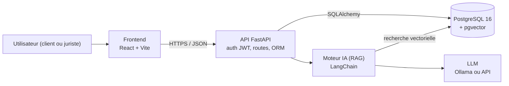
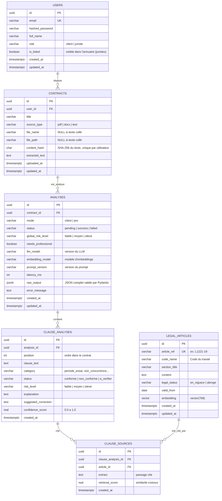

# Architecture & Modèle de Données — I-Légale

> Séance 2 · Document de conception. L'ERD est en 3NF. Les points à confirmer en S3 sont signalés par ⚠️.

---

## 1. Vue d'ensemble

Le backend principal et le moteur IA sont dans le même service FastAPI (module `app/ai`). Ils sont découplés par une interface : l'IA reçoit un texte de contrat et renvoie un JSON validé par Pydantic. Si besoin, l'IA pourra devenir un micro-service séparé sans changer le schéma de base.

---

## 2. Diagramme Entités-Relations

### Cardinalités

| Relation | Cardinalité | Justification |
|:---|:---:|:---|
| `users` → `contracts` | 1 – N | Un utilisateur dépose plusieurs contrats, un contrat appartient à un seul utilisateur. |
| `contracts` → `analyses` | 1 – N | Un contrat peut être ré-analysé (autre modèle, autre mode). On garde l'historique. |
| `analyses` → `clause_analyses` | 1 – N | Une analyse produit un verdict par clause. |
| `clause_analyses` ↔ `legal_articles` | N – N | Une clause cite plusieurs articles et un article est cité par de nombreuses clauses. La table de jonction `clause_sources` porte l'extrait et le score. |

---

## 3. Dictionnaire des données

### `users`
| Attribut | Type SQL | Null | Contraintes | Description |
|:---|:---|:---:|:---|:---|
| `id` | UUID | NON | PK, `DEFAULT gen_random_uuid()` | Identifiant |
| `email` | VARCHAR(255) | NON | UNIQUE | Identifiant de connexion |
| `hashed_password` | VARCHAR(255) | NON | – | Hash bcrypt / argon2 |
| `full_name` | VARCHAR(150) | NON | – | Nom affiché (et dans l'annuaire des juristes) |
| `role` | VARCHAR(20) | NON | `CHECK (role IN ('client','juriste'))` | Rôle, détermine le mode d'analyse |
| `is_listed` | BOOLEAN | NON | `DEFAULT FALSE`, `CHECK (role = 'juriste' OR is_listed = FALSE)` | Le juriste accepte d'apparaître dans l'annuaire (US-08). Un client ne peut pas être listé. |
| `created_at` | TIMESTAMPTZ | NON | `DEFAULT now()` | Date d'inscription |
| `updated_at` | TIMESTAMPTZ | NON | `DEFAULT now()`, mis à jour par trigger | Dernière modification |

### `contracts`
| Attribut | Type SQL | Null | Contraintes | Description |
|:---|:---|:---:|:---|:---|
| `id` | UUID | NON | PK | Identifiant |
| `user_id` | UUID | NON | FK → `users(id)` **ON DELETE CASCADE** | Propriétaire |
| `title` | VARCHAR(255) | NON | – | Titre donné par l'utilisateur |
| `source_type` | VARCHAR(10) | NON | `CHECK (source_type IN ('pdf','docx','text'))` | Format d'entrée |
| `file_name` | VARCHAR(255) | OUI | – | Nom du fichier d'origine |
| `file_path` | VARCHAR(500) | OUI | `CHECK ((source_type='text') = (file_path IS NULL))` | Emplacement de stockage |
| `content_hash` | CHAR(64) | NON | `UNIQUE (user_id, content_hash)` | SHA-256 du texte : empêche de déposer deux fois le même contrat pour un utilisateur |
| `extracted_text` | TEXT | NON | – | Texte extrait, base de la segmentation |
| `uploaded_at` | TIMESTAMPTZ | NON | `DEFAULT now()` | Date de dépôt |
| `updated_at` | TIMESTAMPTZ | NON | `DEFAULT now()`, mis à jour par trigger | Dernière modification |

### `analyses` (stockage de la brique IA)
| Attribut | Type SQL | Null | Contraintes | Description |
|:---|:---|:---:|:---|:---|
| `id` | UUID | NON | PK | Identifiant |
| `contract_id` | UUID | NON | FK → `contracts(id)` **ON DELETE CASCADE** | Contrat analysé |
| `mode` | VARCHAR(10) | NON | `CHECK (mode IN ('client','pro'))` | Profondeur de l'analyse |
| `status` | VARCHAR(10) | NON | `CHECK (status IN ('pending','success','failed'))`, `DEFAULT 'pending'` | État du traitement |
| `global_risk_level` | VARCHAR(10) | OUI | `CHECK (... IN ('faible','moyen','eleve'))` | NULL tant que l'analyse n'est pas terminée |
| `needs_professional` | BOOLEAN | NON | `DEFAULT FALSE` | Règle déterministe (ex. risque élevé) |
| `llm_model` | VARCHAR(100) | OUI | – | Version du LLM utilisé |
| `embedding_model` | VARCHAR(100) | OUI | – | Modèle d'embeddings utilisé |
| `prompt_version` | VARCHAR(50) | OUI | – | Version du prompt (ex. `v1`), pour comparer les prompts |
| `latency_ms` | INTEGER | OUI | `CHECK (latency_ms >= 0)` | Durée totale de l'inférence |
| `raw_output` | JSONB | OUI | – | JSON complet validé, pour audit et rejeu |
| `error_message` | TEXT | OUI | – | Cause de l'échec si `status = 'failed'` |
| `created_at` | TIMESTAMPTZ | NON | `DEFAULT now()` | Date de l'analyse |
| `updated_at` | TIMESTAMPTZ | NON | `DEFAULT now()`, mis à jour par trigger | Passe de `pending` à `success` ou `failed` |

### `clause_analyses`
| Attribut | Type SQL | Null | Contraintes | Description |
|:---|:---|:---:|:---|:---|
| `id` | UUID | NON | PK | Identifiant |
| `analysis_id` | UUID | NON | FK → `analyses(id)` **ON DELETE CASCADE** | Analyse parente |
| `position` | INTEGER | NON | `UNIQUE (analysis_id, position)` | Ordre de la clause dans le contrat |
| `clause_text` | TEXT | NON | – | Extrait de la clause |
| `category` | VARCHAR(50) | NON | – | `periode_essai`, `non_concurrence`, `duree_travail`… |
| `status` | VARCHAR(15) | NON | `CHECK (status IN ('conforme','non_conforme','a_verifier'))` | Verdict |
| `risk_level` | VARCHAR(10) | NON | `CHECK (risk_level IN ('faible','moyen','eleve'))` | Niveau de risque |
| `explanation` | TEXT | NON | – | Explication du verdict |
| `suggested_correction` | TEXT | OUI | – | Correction proposée |
| `confidence_score` | REAL | OUI | `CHECK (confidence_score BETWEEN 0 AND 1)` | Score de confiance |
| `created_at` | TIMESTAMPTZ | NON | `DEFAULT now()` | Date de création. Table immuable : pas de `updated_at`. |

### `legal_articles` (corpus du RAG)
| Attribut | Type SQL | Null | Contraintes | Description |
|:---|:---|:---:|:---|:---|
| `id` | UUID | NON | PK | Identifiant |
| `article_ref` | VARCHAR(30) | NON | UNIQUE | Référence, ex. `L1221-19` |
| `code_name` | VARCHAR(100) | NON | `DEFAULT 'Code du travail'` | Code d'origine |
| `section_title` | VARCHAR(255) | OUI | – | Titre / chapitre |
| `content` | TEXT | NON | – | Texte intégral de l'article |
| `legal_status` | VARCHAR(15) | NON | `CHECK (legal_status IN ('en_vigueur','abroge'))` | Seuls les articles en vigueur sont interrogés |
| `valid_from` | DATE | OUI | – | Date d'entrée en vigueur |
| `embedding` | VECTOR(768) | OUI | – | Embedding pour la recherche sémantique ⚠️ |
| `created_at` | TIMESTAMPTZ | NON | `DEFAULT now()` | Date d'ingestion |
| `updated_at` | TIMESTAMPTZ | NON | `DEFAULT now()`, mis à jour par trigger | Mise à jour du corpus |

### `clause_sources` (table de jonction)
| Attribut | Type SQL | Null | Contraintes | Description |
|:---|:---|:---:|:---|:---|
| `id` | UUID | NON | PK | Identifiant |
| `clause_analysis_id` | UUID | NON | FK → `clause_analyses(id)` **ON DELETE CASCADE** | Clause concernée |
| `article_id` | UUID | NON | FK → `legal_articles(id)` **ON DELETE RESTRICT** | Article cité |
| `extract` | TEXT | NON | – | Passage cité |
| `retrieval_score` | REAL | OUI | – | Similarité cosinus du retrieval |
| `created_at` | TIMESTAMPTZ | NON | `DEFAULT now()` | Date de création. Table immuable : pas de `updated_at`. |
| | | | `UNIQUE (clause_analysis_id, article_id)` | Pas de doublon de citation |

---

## 4. Choix de conception

1. **3NF.** Chaque attribut dépend de la clé, de toute la clé et rien que de la clé.
   - `analyses` n'a pas de `user_id`, car l'utilisateur se déduit de `contracts`. Le contrôle d'accès (US-06) se fait par jointure.
   - Les articles ne sont pas recopiés dans chaque clause : ils sont référencés via `clause_sources`.
   - **Duplications volontaires :** `global_risk_level`, `needs_professional` et `raw_output` sont calculés à partir des clauses. Ils sont stockés pour la performance des requêtes et pour l'audit (instantané du résultat tel que validé), pas par oubli de normalisation.
2. **Deux niveaux pour la sortie IA.** Les verdicts sont stockés dans des colonnes typées dans `clause_analyses`. On peut ainsi filtrer et compter en SQL (« toutes les clauses non conformes »). Le JSON brut complet est gardé en `JSONB` dans `analyses.raw_output`. Il sert à l'audit, au rejeu et à absorber l'évolution du schéma de sortie.
3. **Garde-fou anti-hallucination.** `clause_sources.article_id` est une clé étrangère vers `legal_articles`. Une citation vers un article inexistant est donc impossible en base, en plus de la validation Pydantic. `ON DELETE RESTRICT` empêche de supprimer un article déjà cité.
4. **Politique de suppression.**
   - `CASCADE` sur la chaîne utilisateur → contrat → analyse → clauses → sources : supprimer un compte supprime tout (RGPD).
   - `RESTRICT` sur le corpus légal, qui est une donnée de référence indépendante des utilisateurs.
5. **Traçabilité de l'IA.** `llm_model`, `embedding_model`, `prompt_version`, `latency_ms` et `status` permettent de comparer les modèles et les prompts en S3 et de diagnostiquer les échecs.
6. **Horodatage.** Chaque table a `created_at`. Les tables modifiables (`users`, `contracts`, `analyses`, `legal_articles`) ont aussi `updated_at`, mis à jour automatiquement par un trigger PostgreSQL. `clause_analyses` et `clause_sources` sont des traces immuables : une fois écrites, elles ne changent plus, donc pas de `updated_at`.
7. **Index.**
   - B-Tree sur `contracts(user_id)`, `analyses(contract_id)`, `clause_analyses(analysis_id)` et `clause_sources(article_id)`. Les contraintes `UNIQUE` créent aussi leurs propres index.
   - Index `HNSW (embedding vector_cosine_ops)` sur `legal_articles` pour la recherche vectorielle.
   - Index GIN optionnel sur `analyses.raw_output` si on interroge le JSON.
8. **Hors périmètre, assumé.** Pas de table `audit_logs`, non demandée pour le MVP (le gabarit en propose une à titre d'exemple). Pas de table `convention_collective` (Could Have).

## 5. Points à confirmer

- ⚠️ **Modèle d'embeddings et dimension.** On part sur `multilingual-e5-base` (768 dimensions, textes jusqu'à 512 tokens), car `paraphrase-multilingual-MiniLM-L12-v2` (384 dimensions) tronque à environ 128 tokens, ce qui coupe les articles longs. Choix provisoire : le benchmark de S3 valide ou change le modèle. En cas de changement, il faut modifier `VECTOR(n)` et recalculer tous les embeddings. Avec les modèles E5, le texte doit être préfixé (`query: ` pour les questions, `passage: ` pour les articles).
- ⚠️ **Articles très longs.** Si certains articles dépassent 512 tokens, on ajoutera en S3 une table `article_chunks` (article, numéro de morceau, texte, embedding) et le retrieval se fera sur les morceaux.
- **Mise à jour du corpus.** Un article modifié est mis à jour en place. L'ancienne version citée dans une analyse reste lisible dans `clause_sources.extract`.
- **Annuaire des juristes (US-08).** Il utilise `users.role = 'juriste' AND is_listed = TRUE`, sans table supplémentaire. Si on veut une spécialité par juriste, il faudra ajouter une table `lawyer_profiles`.
